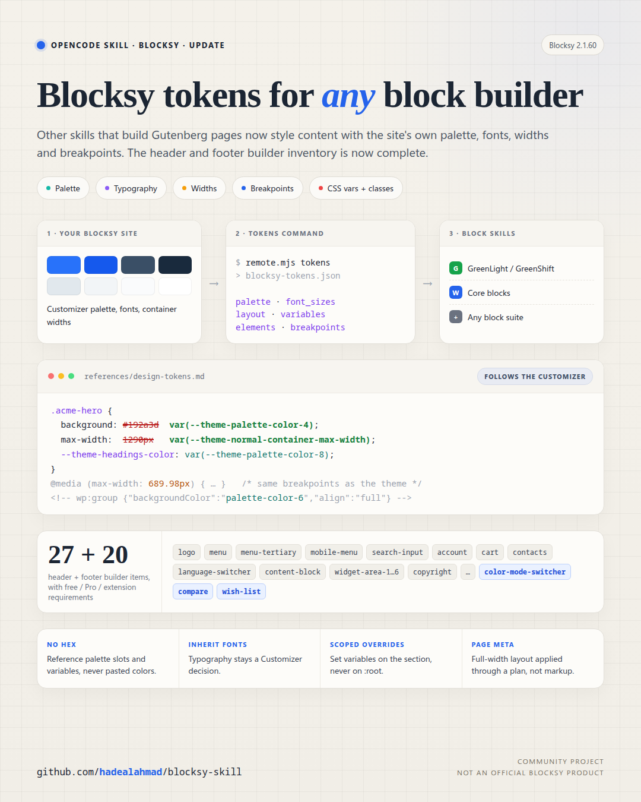
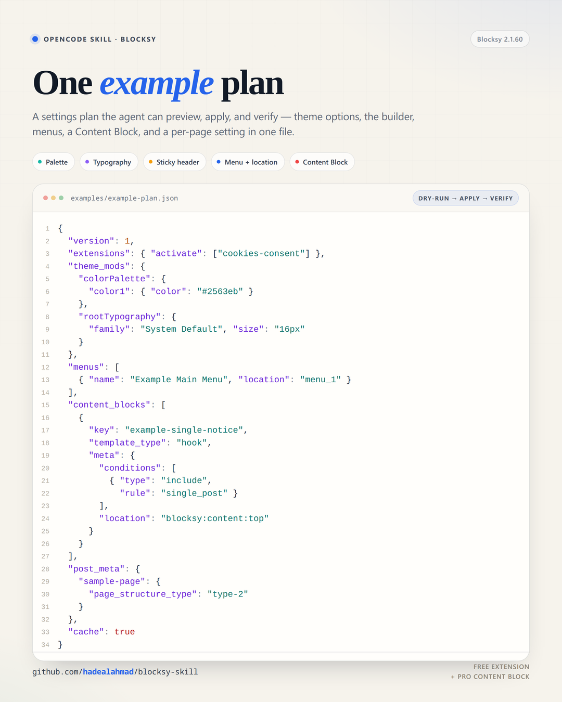

# Blocksy skill

> Repository: <https://github.com/hadealahmad/blocksy-skill>

A portable agent skill (Claude Code, OpenCode, and other agents that read `SKILL.md`) for configuring WordPress sites that run:

- Blocksy
- Blocksy Child
- Blocksy Companion
- Blocksy Companion Pro

It sets global theme options, the header/footer builder, color palettes,
typography, menus, per-page settings, Content Blocks/popups, and extensions.

It also exports the site's **design tokens** (palette, typography, widths,
breakpoints, CSS variables and classes) so other skills that build Gutenberg
pages, such as [GreenLight](https://github.com/wpsoul/greenlight-vibe), core
blocks, or any block suite, style content with Blocksy's variables instead of
hard-coded values. See `references/design-tokens.md`.



## Why there are two adapters

| Access | Adapter |
| --- | --- |
| Shell / SSH / DDEV / LocalWP / WP-CLI | `scripts/wp-local.sh` + `scripts/inspect.php` + `scripts/apply.php` |
| No shell, but plugin install allowed from wp-admin | `dist/blocksy-bridge.zip` + `scripts/remote.mjs` |
| No plugin install, wp-admin + REST only | Core REST for menus/pages/per-page meta (partial) |
| No automation | Generated plan + manual import / manual Content Blocks |

The bridge is a single-file plugin. It exposes a narrow, authenticated REST API
for Blocksy settings. That is what makes full configuration possible when there
is no file or database access.

## Install the skill

Clone it into your agent's skills directory:

```sh
# Claude Code
git clone https://github.com/hadealahmad/blocksy-skill.git ~/.claude/skills/blocksy

# OpenCode
git clone https://github.com/hadealahmad/blocksy-skill.git ~/.config/opencode/skills/blocksy
```

For a single project, clone it to `.claude/skills/blocksy/` or
`.opencode/skills/blocksy/` inside that project instead. The skill entry point
is `SKILL.md`.

## Quick start with WP-CLI

```sh
SITE=/path/to/wordpress
./scripts/wp-local.sh "$SITE" eval-file scripts/inspect.php > current.json
BLOCKSY_INSPECT=export BLOCKSY_INSPECT_PORTABLE=1 \
  ./scripts/wp-local.sh "$SITE" eval-file scripts/inspect.php > backup.json
BLOCKSY_PLAN=examples/example-plan.json \
  ./scripts/wp-local.sh "$SITE" eval-file scripts/apply.php
```

`scripts/wp-local.sh` runs WP-CLI inside the web container for DDEV projects
(see `references/ddev.md`) and discovers the LocalWP MySQL socket automatically.

## Quick start with the bridge

1. Upload `dist/blocksy-bridge.zip` in **Plugins → Add New → Upload Plugin**.
2. Activate **Blocksy Bridge**.
3. **Settings → Blocksy Bridge** → copy the token.
4. Run:

```sh
export BLOCKSY_URL="https://example.com"
export BLOCKSY_TOKEN="..."

node scripts/remote.mjs info
node scripts/remote.mjs schema > schema.json
node scripts/remote.mjs export --portable --post-meta > backup.json
node scripts/remote.mjs apply examples/example-plan.json --dry-run
node scripts/remote.mjs apply examples/example-plan.json
node scripts/remote.mjs tokens > blocksy-tokens.json   # for block-building skills
```

Application Passwords are also supported:

```sh
export BLOCKSY_USER="admin"
export BLOCKSY_APP_PASSWORD="xxxx xxxx xxxx xxxx xxxx xxxx"
```

## Example plan

`examples/example-plan.json` sets a palette and typography, builds a sticky
header and footer, creates a menu, activates a free extension, creates a hook
Content Block, and sets a per-page layout.



## Layout

```text
SKILL.md                  entry point and workflow
references/               adapters, storage, options, builder, content blocks,
                          extensions, menus, verification, plan format
scripts/
  wp-local.sh             DDEV/LocalWP-aware WP-CLI wrapper
  inspect.php             WP-CLI schema/info/export
  apply.php               WP-CLI plan apply
  remote.mjs              Bridge REST client
  restore-plan.mjs        build a plan that returns a site to a backup export
  find-option.mjs         search the option catalogs / a live schema
tests/
  wp-local-ddev.test.sh   DDEV path mapping, fake ddev (bash tests/wp-local-ddev.test.sh)
  *.test.mjs              node --test tests/*.test.mjs
bridge/
  blocksy-bridge.php      single-file bridge plugin source
dist/
  blocksy-bridge.zip      uploadable plugin
data/                     versioned option/builder catalogs, builder item
                          inventory, CSS variable/class catalogs
examples/
  example-plan.json       one end-to-end example
assets/
  example-plan.png        social/repo preview image
  design-tokens.png       design tokens update image (source in assets/src/)
```

## Safety

- The bridge requires an administrator (`manage_options`).
- **Pro gate:** when a request needs a Pro-only feature and the site has the free
  Companion build, stop and ask for Blocksy Companion Pro installation and
  licence activation. Do not fake or bypass it. See
  `references/pro-gate.md`.
- It refuses arbitrary options, arbitrary post types, arbitrary PHP, plugin
  installation, and user management.
- It never returns Freemius/licence secrets.
- Always export a backup before applying a plan.
- Always run `--dry-run` first.
- Prefer HTTPS. Rotate the bridge token if it leaks.
